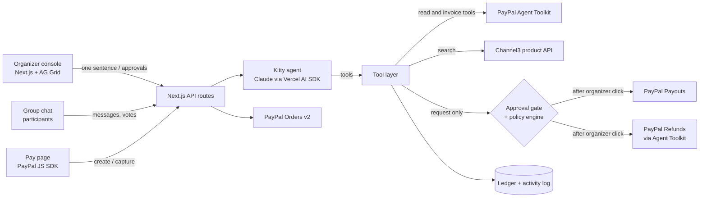

# Kitty: the AI agent that runs your group gift, with PayPal

**Type one sentence. Kitty does the rest.** It collects everyone's share with PayPal, chases the late payers (a friendly nudge, then a real PayPal invoice), finds a real gift within budget, lets the group vote, pays for it **only after the organizer approves**, refunds whatever is left pro rata and signs the card. The organizer's job shrinks to one sentence and one click.

- **Live demo:** [kitty-odg5.onrender.com](https://kitty-odg5.onrender.com) (PayPal sandbox, no real money)
- **Video (under 3 min):** `https://youtu.be/<video-id>`
- Built for the PayPal AI Hackathon 2026 · License: MIT

---

## The problem

People pool money constantly: according to a [2024 PayPal survey](https://newsroom.paypal-corp.com/2024-11-14-PayPal-Unveils-Innovative-Money-Pooling-Feature,-Simplifying-Group-Expenses-Between-Family-and-Friends), US consumers pooled money for group purchases about 86 million times in a year, for gifts, trips and events. Every one of those has the same unpaid hero: the organizer. They chase six people for $20, pick a gift alone, often pay with their own card and spend a week getting reimbursed. PayPal brought money pooling back in 2024, but a pool still needs a human to chase, choose, buy and refund, and contributors have to trust that human with their money.

Kitty is the agent that runs the pool. And because it handles other people's money, it is built around trust: **spending mandates, a human approval gate, hard policy checks in code, and a ledger where every dollar has a PayPal ID.**

## What Kitty does

| Step | Who | What happens | PayPal |
|---|---|---|---|
| 1 | Organizer | Types: *"Birthday kitty for Sarah next Saturday, $20 each from me and 5 colleagues. She loves hiking."* | |
| 2 | Kitty (Claude) | Extracts recipient, date, amount, people and interests; opens the group chat; posts a personal pay link for each person | |
| 3 | Participants | Pay with PayPal Checkout. **Each payment carries a spending mandate**: up to $X, only for this gift, unspent money comes back | Orders v2 (create + capture) |
| 4 | Kitty | Daily check-ins: a personal nudge first, then a **real PayPal invoice**, then a PayPal invoice reminder. If someone pays by link, Kitty cancels their open invoice | Agent Toolkit: `create_invoice`, `send_invoice`, `send_invoice_reminder`, `get_invoice`, `cancel_sent_invoice` |
| 5 | Kitty | "Sorry, only $10 for me": Kitty asks the organizer how to cover the gap (lower the goal, cover it, or split it) and rebalances | |
| 6 | Kitty | Goal reached: searches **real products** within budget and interests (Channel3), proposes 3, the group votes in chat | |
| 7 | Organizer | Approves the purchase on a card that shows every policy check | |
| 8 | Kitty | Pays the merchant from the pooled balance, waits for PayPal to confirm, logs the transaction ID | Payouts v1 |
| 9 | Kitty | Proposes refunding the leftover pro rata; after approval, refunds each original payment | Agent Toolkit: `create_refund` (Refunds API) |
| 10 | Kitty | Writes the card, signed with everyone's wishes from the chat | |

Everything appears live in the organizer console: an **AG Grid ledger** (who paid, how, PayPal IDs, mandates, refunds) and an **AG Grid activity log** of every agent decision, PayPal call and policy block, with filters and search.

## Trust by design

Kitty never moves money on its own. The model only has tools that *request* outgoing payments; execution happens in code after a human click, and policies are checked twice (when requested and right before PayPal is called):

- amount ≤ money actually collected (balance)
- amount ≤ the organizer's spending cap
- purpose matches every contributor's mandate
- mandates not expired
- payee is a configured PayPal merchant account
- refunds: total equals the unspent balance, split pro rata, never more than anyone paid

Ask Kitty in the console to *"buy the $180 tent"* and the policy engine blocks it, logs it in red, and the agent explains why.

## Architecture



- `src/lib/agent.ts`: the agent. One run per event (kitty created, goal reached, a day passes, a message in the group, vote closed, money moved). System prompt, tools, and a scripted fallback if the model is unavailable.
- `src/lib/paypal.ts`: Orders v2 and Payouts over REST; Invoicing and Refunds through `@paypal/agent-toolkit`.
- `src/lib/policy.ts`: the guardrails.
- `src/lib/actions.ts`: business logic (collect, invoice, rebalance, approve, pay, refund, vote).
- `src/components/grids.tsx`: AG Grid ledger and activity log (custom cell renderers, live cell flashing, external filters, quick search, pinned totals, custom Quartz theme). `src/components/MoneyChart.tsx`: AG Charts step chart of the balance, built from the same ledger.

## Tech

| | |
|---|---|
| PayPal | Orders v2, Invoicing v2, Refunds, Payouts v1, **PayPal Agent Toolkit** (`@paypal/agent-toolkit/ai-sdk`), PayPal JS SDK. Sandbox only. |
| AI | Claude (Anthropic API) through the Vercel AI SDK: structured output for the sentence, tool-calling agent for everything else |
| AG Grid | AG Grid Community (React): ledger + activity log. AG Charts Community: money-in-the-kitty step chart |
| Channel3 | Product search API for real, in-stock gifts under budget (falls back to a small fictional demo catalog without a key) |
| Render | Hosting, one-click Blueprint (`render.yaml`) |
| App | Next.js 15, React 19, TypeScript, Tailwind CSS 4 |

## Try it (judges)

1. Open the [live demo](https://kitty-odg5.onrender.com) and click **Create the kitty** (the example sentence is pre-filled).
2. In the phone on the right, tap **Pay $20** on a link and pay with a **PayPal sandbox personal account** (see credentials below, or use any sandbox buyer account you own). The ledger updates live.
3. Click **Skip a day** (top right) twice: Kitty nudges the late payers, then sends real PayPal sandbox invoices.
4. Chat as Priya with the quick reply *"Sorry, I can only do $10"*. Kitty asks the organizer what to do; pick **Lower the goal**.
5. Pay the remaining links. When the goal is reached, Kitty proposes 3 gifts. Vote as a few people, then **Close the vote**.
6. Approve the purchase on the yellow card, then approve the refunds. Open the card.
7. Try the guardrail: in **Ask Kitty**, type *"Buy the $500 tent instead"*.

**Sandbox buyer for testing:** the PayPal sandbox personal account credentials are in the Devpost submission's testing instructions (sandbox test account, no real money). Any sandbox personal account you own works too.

[`/api/health?deep=1`](https://kitty-odg5.onrender.com/api/health?deep=1) shows the live status of PayPal Orders, Invoicing (Agent Toolkit), Claude and the gift search.

> The demo server keeps data in memory and resets on restart. On Render's free plan the first request after a while can take ~50 s to wake up.

## Run it locally

```bash
git clone https://github.com/3179371/kitty.git && cd kitty
cp .env.example .env.local   # fill in your PayPal sandbox app + Anthropic key
npm install
npm run dev                  # http://localhost:3000
```

PayPal sandbox setup (5 minutes):

1. On [developer.paypal.com](https://developer.paypal.com), **Testing Tools > Sandbox Accounts**: create three accounts with country **United States**: a Business account for the kitty pool, a Business account that plays the gift shop, and a Personal account to pay with.
2. **Apps & Credentials > Sandbox > Create App** (Merchant), linked to the pool Business account. Copy the Client ID and Secret. In the app's features, keep **Invoicing** and **Payouts** enabled.
3. Put the gift shop's email in `GIFT_SHOP_EMAIL` and, optionally, the Personal account's email in `SANDBOX_BUYER_EMAIL` so invoices land there.

Without PayPal credentials the app starts in a clearly labelled **mock mode** for UI development only. Without an Anthropic key the agent runs a scripted fallback.

## Deploy on Render

**New > Blueprint**, select this repository, fill in the secret env vars (`PAYPAL_CLIENT_ID`, `PAYPAL_CLIENT_SECRET`, `GIFT_SHOP_EMAIL`, `SANDBOX_BUYER_EMAIL`, `ANTHROPIC_API_KEY`, optional `CHANNEL3_API_KEY`) and deploy.

## Honest notes

- Everything runs in the PayPal **sandbox**. In the sandbox, the gift is paid with a Payout to a sandbox merchant account that stands in for the retailer. In production this step becomes a regular PayPal checkout with the merchant.
- The group chat is simulated inside the app (you can chat as each person). Plugging the same agent into WhatsApp, Slack or iMessage is next.
- Built from scratch during the hackathon submission period.

## What's next

Real chat apps, proactive birthday reminders, recurring kitties (team lunches, shared subscriptions), merchant checkout through PayPal's agentic commerce services, and multi-currency kitties.

## License

[MIT](LICENSE)
